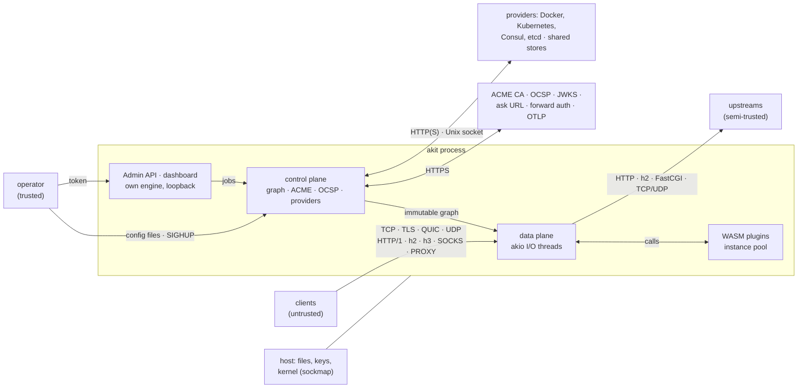

# Threat model

[English](threat-model.md) | [简体中文](threat-model.zh-CN.md)

What akit protects, from whom, and how: the assets, the trust boundaries, the attacks at each
boundary with the controls akit has against them (the code and the tests that hold each), and the
known limitations with their plans. It is written for the external security review of 1.0
([review scope](review-scope.md)) and kept true as akit changes: a change that adds a boundary, an
asset or a control updates this page in the same commit, as [rule 26](../rules.md) keeps both
languages together. How to report a problem is in [SECURITY.md](../../SECURITY.md).

Written in I80 (2026-11-26) against akit `main` at `953cb57` with I80's changes, on akio
`0fc8f3a7` (`1.0.0-rc.1`); brought up to date by I80b (2026-11-26, akit `main` at `20caeedc` with
I80b's changes, akio `6bcd8ad6`), which closed the limitations L2, L3, L4, L6, L7, L12, L13 and L14.
Paths are relative to the repository's root; a test is named by its function, in the file given or
in the crate's own tests.

- [What akit is, for this model](#what-akit-is-for-this-model)
- [Assets](#assets)
- [Actors and trust boundaries](#actors-and-trust-boundaries)
- [Assumptions](#assumptions)
- [Clients](#clients)
- [Upstreams](#upstreams)
- [The Admin API and the dashboard](#the-admin-api-and-the-dashboard)
- [Certificates: files, ACME, on-demand TLS, OCSP](#certificates-files-acme-on-demand-tls-ocsp)
- [Providers and shared stores](#providers-and-shared-stores)
- [Plugins](#plugins)
- [The host](#the-host)
- [Across every boundary](#across-every-boundary)
- [Known limitations](#known-limitations)

## What akit is, for this model

akit is one process: a reverse proxy, TLS terminator, static file server, layer 4 proxy, forward
proxy and API gateway, configured by fit's config ([decision 002](../decisions/002-config-compatibility.md)).
Its **data plane** runs on akio's I/O threads (connections, requests, handshakes, relays); its
**control plane** runs off them (the config compiled into an immutable graph, the Admin API on an
engine of its own, providers, ACME, OCSP, health probes), and publishes graphs the data plane
reads ([architecture](../architecture.md)). Work that blocks goes to bounded pools (akio's logical
pool, the WASM instance pool, ACME's and OCSP's workers), never an I/O thread ([rule 1](../rules.md)).

The release binary is akit's code and akio's, nothing else ([decision 030](../decisions/030-supply-chain-checks.md)):
akio does the I/O, the HTTP/1, HTTP/2 and HTTP/3 parsing, QUIC, TLS, X.509, the cryptography, the
compressors, the regex engine and the WebAssembly interpreter. akit has no `unsafe`
([rule 14](../rules.md)); akio's `unsafe` is confined and reviewed
([akio's unsafe review](https://github.com/lesismal/akio/blob/main/docs/unsafe-review.md)).

## Assets

| Asset | Where it lives | Why it matters |
| --- | --- | --- |
| Private keys of served certificates | key files (`tls.certificates`), the certificate storage (`acme.storage`, a shared store), memory | impersonation of every site akit serves |
| The ACME account key | the certificate storage (`acme/<ca>/account.pem`) | issuance and revocation of certificates for akit's names |
| Admin API token | `admin.token_file`, memory | full control of the config: where traffic goes, what is served |
| Credentials akit holds for others | files named by the config: JWT secrets, provider and store tokens and passwords, OTLP headers, upstream client keys | access to the services they open |
| The running config and its history | memory (`akit_admin::Configs`), the files it was read from | routing, access rules; secrets written inline |
| Traffic in transit | sockets, akio's buffers, the cache (memory and disk tiers) | confidentiality and integrity of every request and response, credentials in headers |
| Route decisions | the graph: matchers, middleware (auth, limits, access rules) | a request routed past its middleware reaches what it should not |
| Availability | I/O threads, connection and memory budgets, pools | one client or upstream taking the gateway from everyone |
| The host | the process's user, files it can read, ports it can reach | akit as a stepping stone (SSRF, file disclosure) |

## Actors and trust boundaries

| Actor | Trust | Reaches akit through |
| --- | --- | --- |
| Clients | none: anyone on the network | listeners: every byte, handshake and datagram |
| Upstreams | semi-trusted: chosen by the operator, but their answers are parsed as untrusted input and may be slow or compromised | the proxy's, FastCGI's and L4's connections |
| The operator | trusted: writes the config, its files and the environment | config files, SIGHUP, the Admin API with its token |
| Local processes | untrusted, unless the operator gives them the token or the Unix socket | the Admin API's loopback address or socket |
| Web pages in the operator's browser | untrusted | the Admin API, through the browser (CSRF, DNS rebinding) |
| Providers and shared stores | trusted for what they may change, untrusted as parsers' input | their APIs, called by akit |
| Remote services akit calls (ACME CA, OCSP responders, JWKS, the ask URL, forward auth, OTLP collector) | trusted for their answer's meaning, untrusted as input | akio's HTTP client |
| Plugin modules | trusted to be the operator's choice, confined as code | the instance pool, their host functions |

## Assumptions

- **The config is trusted.** Whoever can write akit's config, its files or its environment controls
  akit: it can proxy anywhere, serve any file the process can read, load plugins, and set every
  limit. The Admin API is that same power, guarded by its address and token.
- **The host is trusted** as far as the process's user: its file permissions, its kernel, its
  clock and its CA bundle (`akio::tls::RootCerts::system`).
- **Upstreams answer what the operator asked them to**, but akit does not let an upstream's
  answer break the client's connection, its framing, or another request.
- **akio is correct** for this model; its own threats are akio's ([akio's
  policy](https://github.com/lesismal/akio/blob/main/SECURITY.md)), and the review's scope says
  which of its parts the external review looks at.

## Clients

### Parsing, framing and smuggling

| Attack | Controls | Tests |
| --- | --- | --- |
| Request smuggling over HTTP/1.1: `Content-Length` with `Transfer-Encoding`, two lengths, a coding other than chunked, a bad chunk size, obsolete line folding | akio-http's parser refuses each (400, or 501 for a coding it does not know; akio API request A169) before a handler runs; the proxy writes its own framing upstream and drops the client's `Content-Length`, `Transfer-Encoding` and `TE` (`crates/akit-proxy/src/headers.rs`, `request_field`) | `crates/akit/tests/conformance.rs`: `h1_smuggling_with_content_length_and_transfer_encoding`, `h1_bad_requests_get_400_and_reach_nothing`, `h1_a_bad_chunk_size`, `h1_obs_fold` |
| Malformed HTTP/2 and HTTP/3 requests: pseudo-headers, connection-specific fields, a length that disagrees with the body | akio's h2 and h3 servers (A169); the proxy drops pseudo-headers and hop-by-hop fields | `h2_malformed_requests_are_refused_and_reach_nothing`, `h2_content_length_that_disagrees_with_the_body` (conformance); h2spec (I25) |
| A missing or repeated `Host`; an absolute-form target | akio refuses a missing or second `Host` on HTTP/1.1 (400); the proxy refuses two `Host` fields (`headers.rs`, `Refused`); absolute-form targets are routed by their path and sent upstream in origin form (`crates/akit-proxy/src/lib.rs`, `origin_form`; I77) | `h1_absolute_form_target`, `refused_field_values_and_two_hosts` |
| Paths that reach a route they should not: dot segments, `%2E`, `//`, `%2F` and `%5C` hiding a segment, escapes that do not decode | every request path is made canonical before routing (`crates/akit-router/src/path.rs`, `canonicalize`), and one that cannot be is refused 400 by the listener: so routes, `strip_prefix` and the static handler see the same path | `fits_canonicalize`, `non_utf8_escapes` (`path.rs`); `canonical_path` (`crates/akit-proxy/tests/proxy.rs`); fuzz targets `router_path`, `router_find` |
| Parsers akit owns given hostile input: expressions, JWTs, Basic credentials, `Accept-Encoding`, `Forwarded`, `grpc-timeout`, cache directives, ClientHello routing, PROXY headers (akio-mux's) | no panic on peer input ([rule 15](../rules.md): `unwrap`, `expect`, indexing and unchecked arithmetic denied by Clippy in non-test code, CI's `-D warnings`); each parser fuzzed | I77's targets (`fuzz/`), their corpora replayed by `cargo test`; akio's own targets for its parsers |

### Resource exhaustion

| Attack | Controls | Tests |
| --- | --- | --- |
| Too many connections | `limits.max_conns` (100,000, process-wide) as akio's `max_connections`; `services[].max_conns` on L4; the Admin API's 16 | `connection_limit` (`crates/akit-listener/tests/limits.rs`), `tcp_max_conns` (`l4.rs`) |
| Slow clients (slowloris): a head sent a byte at a time, a body that stalls, reads that never drain | akio-http: the head within 10 s of its first byte (408), 60 s without a body byte; idle keep-alive 120 s (`CLIENT_IDLE_TIMEOUT`, as fit's); `limits.write_stall_timeout` (30 s) for a client that stops reading; `limits.max_write_queue_bytes` (32 MiB) | `client_idle_timeout_is_fits`, `write_stall_timeout`; slow and cut clients in each feature's tests ([rule 18](../rules.md)), e.g. `clients_cut_and_slow` (WASM), `slow_peers_and_cut` (CONNECT) |
| Large heads and bodies | `limits.max_header_bytes` (1 MiB: 431, and HTTP/2's and HTTP/3's header list limits), `limits.max_body_bytes` (16 MiB: 413 from `Content-Length` before the handler, or as it arrives), `body_limit` per route; bodies streamed, never buffered whole but where a feature needs it, under a limit ([rule 7](../rules.md)) | `header_limit`, `header_limit_default`; `body_limit` (`crates/akit-proxy/tests/proxy.rs`); `h1_a_header_past_the_limit` |
| Floods of HTTP/2 control frames, resets, QUIC packets | akio's budgets (HTTP/2 reset and flood budgets, QUIC limits) | akio's |
| Tables keyed by client input growing without bound | every one bounded ([rule 11](../rules.md)): `rate_limit` (`max_keys` 100,000, 64 shards, sampled eviction, a header key under keyed SipHash: `crates/akit-middleware/src/limit.rs`), basic auth's checks in flight (1,024), on-demand TLS's names and refusals, the cache's zones | `rate_limit`, `rate_limit_by_header`, `captures_are_bounded`, `max_names` |
| Expensive work forced per request: bcrypt, JWT signatures, WASM calls, cache fills | bcrypt on akio's pool, at most 1,024 at once, remembered by an HMAC once verified (`auth.rs`); JWT signatures verified once per token and kept; WASM on a bounded pool with a bounded queue (503 when full); the cache lock (one fill for a stampede) | `basic_auth_checks_off_the_io_thread`, `never_blocks`, `wait_timeout` |
| An I/O thread blocked or panicking | nothing on an I/O thread blocks ([rule 1](../rules.md); akio's slow-callback detector on in every test run); no panic on peer input (above) | each crate's tests under the detector |

### Routing past the route's checks

| Attack | Controls | Tests |
| --- | --- | --- |
| Spoofed client address: `X-Forwarded-For`, `Forwarded`, `X-Forwarded-Proto`, `X-Forwarded-Host` sent by the client | from a peer outside `trusted_proxies` (none by default) each is discarded and rebuilt from the connection (`headers.rs`, `outgoing`, `is_trusted`); `rate_limit` and `remote_ip` read `X-Forwarded-For` only from trusted peers (`limit.rs`, `client_ip`) | `forwarded_untrusted`, `forwarded_trusted`, `trusted_forwarding`, `client_ips`; fuzz `proxy_headers`, `middleware_fields` |
| A spoofed PROXY protocol header | parsed only from `proxy_protocol.trusted` peers, within 10 s and 4,096 bytes; from others the bytes are the stream's, never an address | `proxy_protocol_http` (`crates/akit-proxy/tests/proxy_protocol.rs`), `proxy_header_names_the_client` (`socks.rs`), `client_proxy_header_stays_in_userspace` (`sockmap.rs`) |
| Header injection into the upstream request: CR, LF or NUL in a value, a field the client sends to pose as an auth result (`X-User` from `jwt`, `copy_headers` from `forward_auth`) | values with NUL, CR or LF and bad field names refused (`headers.rs`, `Refused`); a client's fields matching a claim header or a forward-auth header, in any `_` or `-` spelling, are removed before akit sets them (`jwt.rs`, `forward.rs`, `same_field`) | `refused_field_names`, `refused_field_values_and_two_hosts`, `jwt_claims_headers`, `forward_auth_request_headers`, `same_fields` |
| Basic auth: guessing, timing | bcrypt hashes only (`password_hash`); an unknown user checked against a decoy hash, so timing does not tell users apart; the remembered HMAC compared in constant time; `Authorization` not forwarded unless `forward_authorization` | `basic_auth`, `basic_auth_forward_authorization` |
| JWT: `alg: none`, algorithm confusion (an HMAC check with a public key), `crit`, expired tokens, weak keys | `none` and `crit` never accepted; algorithms limited to `allowed`, each bound to its key's kind (`jws.rs`, `Key::fits`), HMAC secrets only from the config's secret file (32 bytes at least), never from a JWK; RSA under 2,048 bits refused; `exp` required, `nbf` checked with leeway; tokens at most 16 KiB; HMAC compared in constant time | `jwt_algorithms`, `jwt_claims`, `claims_checked`; fuzz `jwt_token`, `jwks_keys` |
| Client certificates | `tls.client_auth` (`require` by default, or `verify_if_given`) against the listener's CA files; `client_cert` per route; a change of CA files reopens the listener | `client_auth_require_and_verify_if_given`, `client_auth_over_h3`, `client_cert`, `new_client_authorities_reopen_the_listener` |
| Cache poisoning and leaks: a response for one user served to another, a key that ignores what the upstream read | the key is the scheme, the host and the target (`crates/akit-cache/src/cache.rs`, `key_of`); `Vary` honoured; not stored: `no-store`, `private`, `no-cache` (revalidated), `Vary: *`, `Set-Cookie`, `Content-Range`; a request with `Authorization`, or a route with auth middleware, stored only when the response allows a shared cache (`public`, `s-maxage`, `must-revalidate`); forwarding headers from untrusted peers are rebuilt from the connection, so they cannot vary an answer unseen | `vary`, `authenticated_not_shared`, `storable`; fuzz `cache_semantics` |

### Files, FastCGI and the forward proxy

| Attack | Controls | Tests |
| --- | --- | --- |
| Path traversal in `static`: `..`, NUL, backslashes, escaped or not; dotfiles | the canonical path (above), then the handler's own scan refuses `..`, NUL and `\` (400: `crates/akit-handler/src/static_files.rs`, `scan`); `dotfiles: deny` by default (404 but `/.well-known`), `try_files` candidates too; only regular files opened, on akio's pool; listings HTML-escaped; symbolic links under the root followed wherever they lead, as fit's (L7, documented in the reference) | `traversal`, `browse`, `symlinks_out_of_the_root_followed` (`crates/akit-handler/tests/static_files.rs`), `traversal_is_unsafe`, `dotfiles_are_hidden`; fuzz `static_path` |
| FastCGI: a script outside the root, httpoxy | `SCRIPT_FILENAME` joined under the root from a cleaned path, `..`, NUL and `\` refused, dotfiles hidden (`crates/akit-handler/src/fastcgi/params.rs`, `crates/akit-config/src/fastcgi.rs`); the client's `Proxy` field never becomes `HTTP_PROXY` | `params`, `dotfiles`, `fields`, `cleans`; fuzz `fastcgi_paths`, `fastcgi_response` |
| The forward proxy (SOCKS, CONNECT) used to reach internal services (SSRF), DNS rebinding | `clients` is required; destinations checked against `allow`, `deny` and `ports` before dialing and again on the address connected to (`crates/akit-l4/src/forward.rs`); loopback, link-local (cloud metadata), unspecified, multicast and the host's own addresses refused unless `allow` names them, IPv4-mapped addresses unmapped first; SOCKS BIND and UDP ASSOCIATE refused | `rules_dest`, `rules_internal`, `netguard_internal_and_refused`, `tunnels_and_refusals`, `refusals`; fuzz `l4_forward` |

### TLS from clients

| Attack | Controls | Tests |
| --- | --- | --- |
| Downgrade, weak ciphers | TLS 1.2 and 1.3 only (`max_version` may lower the top to 1.2, never the floor); akio's suites: ECDHE with AES-GCM or ChaCha20-Poly1305 only, no CBC, no RSA key exchange; HTTP/3 TLS 1.3 only (`crates/akit-tls/src/lib.rs`, `server_configs`) | `alpn_follows_the_listeners_protocols`; akio's TLS tests |
| 0-RTT replay | early data is off: akio's `max_early_data` is 0 and akit never enables it | — (no code path) |
| SNI: a name akit has no certificate for | the first certificate is served, as fit does (`crates/akit-tls/src/certs.rs`, `choose`); routing is by `Host`, not by SNI, on HTTP | `chooses_as_fit`, `sni_picks_the_certificate` |
| The ACME TLS-ALPN-01 certificate served to a client | only to a ClientHello offering `acme-tls/1` alone, for a name being validated; such a connection closes after its handshake | `tls_alpn_challenges_as_fit`, `acme_tls_connections_serve_nothing` |
| On-demand TLS used to make akit request certificates for any name (CA rate limits, storage) | `tls.on_demand` needs `acme.on_demand` with an `ask` URL (refused otherwise); the name is checked (letters, digits, hyphens, a dot, no address) before asking; asks bounded (8 at once, one per 200 ms, a burst of 20), refusals remembered for a minute (10,000 at most), issuance at `rate` per `interval` (10 a minute) and `max_names` (1,000), waiters bounded (1,024 a name); handshakes wait without holding an I/O thread | `obtains_a_certificate_during_the_handshake`, `a_name_past_the_rate_fails_at_once`, `refused`, `rate_limited`, `max_names`, `ask_bounds`, `https_ask`, `on_demand_names_as_fit` |

### Layer 4 and the sockmap relay

| Attack | Controls | Tests |
| --- | --- | --- |
| Idle or slow relays holding resources | `services[]` idle timeouts, `max_conns`, linked backpressure both ways; on the sockmap path, idle time read from the sockets' TCP counters | `tcp_idle_timeout`, `udp_sessions_expire`, `slow_client_gets_everything`, `idle_timeout_from_counters` |
| The eBPF relay bypassing a check | spliced only for plain `tcp` services after the upstream connects: never with TLS terminated, never when the client sent a PROXY header, never past akio's 16,384 pairs; a relay that does not load (privileges, kernel before 6.15) falls back to userspace with the same bytes and timeouts ([decision 010](../decisions/010-sockmap-relay.md)) | `splices_and_echoes`, `client_end_forwards_everything`, `upstream_end_forwards_everything`, `sni_passthrough_spliced`, `proxy_header_goes_first` |

## Upstreams

| Attack | Controls | Tests |
| --- | --- | --- |
| A response that breaks the client's framing: hop-by-hop fields, `Connection`-named fields, a bad `Content-Length` | the proxy drops hop-by-hop and `Connection`-named fields from responses (`headers.rs`, `incoming`) and frames the client's response itself; akio's client parses the upstream as untrusted | `hop_by_hop_response`, `h1_connection_specific_fields_from_the_upstream_are_dropped`, `response_fields` |
| A slow or silent upstream | connect, `response_header_timeout`, `response_idle_timeout`, `response_timeout` and the route's `timeout` (504); the upstream request given up when the client goes; passive and active health checks; circuit breakers; retries under a budget | `connect_timeout`, `timeout_before_head`, `response_header_timeout`, `response_idle_timeout`, `cut_short_mid_body`, `client_abort` (`crates/akit-proxy/tests/failure.rs`); `crates/akit-proxy/tests/retry.rs` |
| A large or endless response | streamed with linked backpressure (`hold_reads` / `on_drain`), never buffered whole; the cache and mirrors under their own limits | `stream_download`, `stream_upload`, `stream_download_from_h2c` (`crates/akit-proxy/tests/stream.rs`, memory bounded while the client reads slowly) |
| An upstream impersonated on the network (h2 over TLS) | verification always on, against the system's CAs or `tls_ca_file`; no option to skip it; `tls_server_name`; a client certificate if configured (`crates/akit-tls/src/upstream.rs`) | `client_certificate`, `server_name`, `http1_fallback_keeps_the_name_and_the_certificate` (`crates/akit-proxy/tests/upstream_tls.rs`) |
| A FastCGI application's answer | records read under limits, the CGI header parsed as untrusted (`fastcgi/record.rs`, `exchange.rs`) | `timeouts_and_limits`; fuzz `fastcgi_response` |

Plain HTTP and h2c upstreams are as trusted as the network between akit and them: the operator's
choice, as in fit.

## The Admin API and the dashboard

| Attack | Controls | Tests |
| --- | --- | --- |
| Reached from the network | off unless `admin` is set; its address must be a loopback one or a Unix socket created with mode 0600, unless it has a token and TLS (I92: `cert_file`, `key_file`, and `client_ca_file` for client certificates verified in the handshake; a config error otherwise: `crates/akit-config/src/model.rs`, `admin`); served on an engine of its own, so a busy data plane does not hold it up ([decision 006](../decisions/006-admin-api.md)) | `refused`, `defaults_and_values` (`crates/akit-config/tests/admin.rs`), `unix_socket`, `tls`, `tls_client_ca`, `tls_start_errors` |
| Another local user or process | `token_file`: a bearer token on every request but the dashboard's static files, compared in constant time (`crates/akit-admin/src/server.rs`, `guard`, `same`); a token file its group or others may read is warned of (below, the host) | `token`, `tokens_compared`, `dashboard_token`, `edits_dry_runs_and_rollbacks_behind_the_token`, `cache_purge_guarded` |
| A web page in the operator's browser (CSRF, DNS rebinding) | any request with an `Origin` is refused (403) but a read from the API's own origin; without a token, the `Host` must name a loopback host, so a rebound name is refused | `browsers_refused`, `loopback_hosts`, `cache_purge_guarded` |
| Inline secrets read through the API (whoever holds the token, the dashboard, a log of its answers) | every read of the config (`/config` and its pointers, `/versions/{n}`, `/config/effective`) answers `[redacted]` for each string under a member fit's `secretName` takes for a secret (`crates/akit-admin/src/redact.rs`); a change that sends `[redacted]` back keeps the secret in its place, one with no secret there is refused (400); the `ETag` stays the config's ([decision 035](../decisions/035-admin-api-redacts-secrets.md)) | `secrets_redacted`, `redacts_secrets_only`, `redacts_under_a_pointer`, `restores_by_member_name_and_index` |
| Large or slow requests | config bodies streamed under `max_config_bytes` (4 MiB: 413), other bodies under 64 KiB; 10 s for a head, 60 s without a body byte, 60 s idle; `max_conns` (16); HTTP/1.1 only | `loads_refused`, `edit_limits_and_cut_clients`, `slow_and_cut_clients`, `connection_limit` |
| A change that breaks the running gateway, lost updates | every change compiled before it is applied (a broken one is refused and the running config kept); `?dry_run=1` compiles without applying; `If-Match` compared under the lock that orders applies (412); history and rollback | `dry_run`, `dry_run_removes_listener`, `if_match_every_change`, `concurrent_writers`, `rollback` |
| The dashboard used for XSS or clickjacking | its own files only, read-only, with `Content-Security-Policy: default-src 'none'; script-src 'self'; connect-src 'self'; frame-ancestors 'none'`, `X-Frame-Options: DENY`, `nosniff`, `Referrer-Policy: no-referrer`; the token kept in `sessionStorage` | `dashboard`, `dashboard_read_only`, `the_dashboard_and_the_status` |
| A provider rewriting the Admin API or other control-plane settings | a provider's part may hold only `listeners`, `routes`, `upstreams` and `services`; the base config wins every name both define (`crates/akit-provider/src/merge.rs`) | `parts_refused`, `parts_refused_more`, `merges` |

### The console

The console (`admin.console`, I89–I91, [decision 036](../decisions/036-console.md)) serves the
Admin API's endpoints behind logins, and fit's workbench pages.

| Attack | Controls | Tests |
| --- | --- | --- |
| Reached from the network, passwords read on the way | off unless `admin.console` is set; an address off loopback must have `cert_file` and `key_file` (a config error otherwise); `admin.console.access`, then the global access, at accept | `console_refused` (`crates/akit-config/tests/admin.rs`), `over_tls`, `access_at_accept`, `console_under_akit_run` |
| Guessed passwords | bcrypt hashes only (no clear text in the config); a name that is no user's checked against a dummy hash; 2 checks at once on a pool of their own (1 thread, 16 waiting, then 503), never on the I/O thread; 5 failures from an address (an IPv6 /64) in 15 minutes lock it out for 15 minutes, doubling to an hour, one check from an address at a time, 4,096 addresses kept; 10 failures in a row as a user slow its checks from 2 s to 5 min (`crates/akit-admin/src/console/login.rs`) | `lockout`, `admit_attack`, `admit_full_table`, `user_backoff`, `address_backoff`, `logins_refused` |
| A stolen or replayed session | 32 random bytes in an `HttpOnly`, `SameSite=Strict` cookie (`Secure` over TLS), kept by their SHA-256; ended idle (30 min), past their lifetime (12 h), at logout, or as the oldest past `max_sessions`; in memory only | `sessions`, `sessions_end` |
| A web page in the operator's browser (CSRF, clickjacking, XSS) | every request but a read carries the session's CSRF token in `X-Fit-Csrf` (compared in constant time); a request whose `Origin` is not the console's is refused; a Content-Security-Policy of the pages' own files and origin, `frame-ancestors 'none'`, `X-Frame-Options: DENY`, `nosniff`, `Referrer-Policy: no-referrer`, HSTS over TLS; the API's answers `Cache-Control: no-store` | `login_and_edit`, `pages_and_schema`, `over_tls` |
| Connections held without a login | `max_conns` at accept; head 10 s, body 30 s, idle 2 min; an answer without a valid session closes its connection. fit's 5 s bound and eviction wait for akio's A232 | `login_and_edit` |
| Who changed what | the `admin` logger: logins and where from, failures, logouts, each change with the version it applied; the console's configs are in `/versions` as source `console` | `login_and_edit`, `console_under_akit_run` |

## Certificates: files, ACME, on-demand TLS, OCSP

| Attack | Controls | Tests |
| --- | --- | --- |
| A certificate and key that do not match, a file swapped mid-write | each pair checked when loaded (`load_pair`); files at most 1 MiB; `-watch-certs` reloads once the files settle, and a bad pair keeps the running config | `problems_name_the_certificate_or_file`, `reloads_once_the_files_settle`, `a_certificate_replaced_under_traffic` |
| Keys disclosed from storage | the file storage creates directories 0700 and files 0600 (`create_new`), written to a temporary name, synced and renamed, the directory synced after the rename; its root and the directories under it that it writes into are tightened to 0700 when left open to others (`FileStorage::prepare`); the config names key files, so the Admin API's answers hold paths, not keys, and a key file its group or others may read is warned of (`crates/akit-config/src/hardening.rs`) | `stores_loads_lists_and_deletes` (checks the mode), `an_open_storage_directory_is_tightened`, `secret_files_open_to_others`, `validate_warns_of_exposed_secrets` |
| Path tricks in storage keys | keys that would leave the storage's root are refused (`crates/akit-tls/src/storage.rs`) | `crates/akit-tls/tests/storage.rs` |
| HTTP-01 answers abused | answered only on listeners in the clear, before routing, for tokens the CA gave (base64url); an answer is public by design; lookups in a shared store bounded (16 at once, 4 per client, 5 s) | `obtains_serves_and_keeps_a_certificate` (HTTP-01 against Pebble), `a_challenge_nobody_has_is_404` |
| A hostile or slow CA, OCSP responder, ask URL | each on its own engine and workers, off the I/O threads; responses capped (1 MiB ACME, 64 KiB OCSP and ask), timeouts (30 s a request, 600 s an order, 10 s OCSP and ask), no redirects to the CA or OCSP, backoff from 60 s to an hour; OCSP responses verified against the issuer, matched to the certificate and never stapled past `nextUpdate`; a certificate from files has its responder asked only if its chain verifies and the responder is at a public address | `a_slow_responder_is_bounded`, `refreshes_keeps_and_drops_responses`, `certificates_from_files_not_trusted_are_not_asked`, `responders_of_files_at_private_addresses_are_not_asked`, `stapled_in_a_handshake`, `renews_when_ari_says` |

## Providers and shared stores

| Attack | Controls | Tests |
| --- | --- | --- |
| A provider's API sends huge or hostile documents | every answer capped (Docker: 16 MiB lists, 1 MiB events; Consul and etcd: 32 MiB; Kubernetes: 64 MiB pages, token files 64 KiB) and its objects counted (`max_containers` 1,000, `max_services` and `max_keys` 1,000, `max_objects` 10,000); parts at most 16 MiB; parsed by akit's own readers, fuzzed | `list_fails`, `bad_events`, `catalog_max_services`, `provider_max_keys`; fuzz `provider_docker`, `provider_kubernetes`, `provider_consul`, `provider_kv`, `provider_merge` |
| A provider takes over the gateway | parts limited to four kinds, the base config winning (above); providers' changes applied as versions, compiled first like any other | `providers`, `file_and_providers` (`crates/akit-admin/tests/providers.rs`) |
| Kubernetes credentials misused | in-cluster: the service account's token, the cluster CA required, `https` forced; kubeconfig `exec` and auth-provider plugins refused (no command run); the token re-read every minute; a kubeconfig's `http://` server or `insecure-skip-tls-verify` off loopback warned of in the provider's log (`RestConfig::exposed`) | `kubeconfigs`, `token_rotates`, `cert_files` |
| Shared certificate stores (Redis, etcd, Consul) | credentials from files; TLS with the system's CAs or `ca_file`; locks leased (a crashed instance's lock expires); replies parsed under limits; a store reached in the clear off loopback, or a provider's token or password sent so, warned of (`crates/akit-config/src/hardening.rs`, `cleartext`) | `redis_shares_keys_and_locks`, `etcd_shares_keys_and_locks`, `consul_shares_keys_and_locks`, `credentials_in_the_clear`; fuzz `tls_redis_reply` |

Providers can add listeners (Consul KV, etcd, Kubernetes): whoever writes a provider's source can
open ports and route traffic, as in fit. That is the trust the operator gives the source.

## Plugins

| Attack | Controls | Tests |
| --- | --- | --- |
| A plugin escapes its sandbox | akio-wasm is an interpreter (no machine code generated, no `unsafe`, [decision 008](../decisions/008-wasm-runtime.md)); a plugin reaches its own memory and the host functions it is given: fit's ABI (`header_get`, `header_set`, `header_add`, `header_del`, `request_get`, `respond`, `log`) and Proxy-Wasm's subset ([decision 011](../decisions/011-proxy-wasm.md)); WASI with no arguments, environment, files or sockets; Proxy-Wasm's calls out, shared data, queues and foreign functions answer `Unimplemented`, so a plugin has no network | `calls`, `errors`, `close_context_traps`, `load_errors` |
| A plugin runs forever or eats memory | a deadline per call (`timeout`, 100 ms, a trap past it), `max_memory_bytes` (128 MiB, at most 4 GiB), `instances` (at most 1,024), a bounded queue (`queue`, 503 when full, `wait_timeout` 1 s), `max_streams`, `max_body_bytes` (1 MiB); an instance made again after a trap | `failures`, `never_blocks`, `wait_timeout`, `max_streams`, `max_body_bytes` |
| A plugin corrupts what akit sends | field names must be tokens, values without CR, LF or NUL, `:path` a path; at most 1,024 changes a header map and 256 metrics; local responses' bodies at most 1 MiB, log lines 64 KiB | `headers`, `respond`, `routing`, `properties`; fuzz `plugin_pairs` |
| A plugin blocks an I/O thread | plugins never run on an I/O thread: the request is suspended while its call waits for and runs on the pool | `never_blocks`, `clients_cut_and_slow` |
| A hostile module file | read when the config is compiled, at most 64 MiB, validated by akio-wasm before it runs | `reading_is_bounded` |

## The host

| Attack | Controls | Tests |
| --- | --- | --- |
| akit's privileges misused | the systemd units run akit as the `akit` user with `CAP_NET_BIND_SERVICE` alone (ambient and bounding set) and `NoNewPrivileges` (`deploy/systemd/akit.service`, [decision 009](../decisions/009-packaging.md)); the image runs as distroless's `nonroot` user; the sockmap relay's `CAP_BPF` and `CAP_NET_ADMIN` are needed only when a listener asks for it, and akit runs without them | `deploy/systemd/test.sh` (CI's packaging job) |
| Files read through the config | the config is trusted (assumptions); files named by peers never are: static and FastCGI paths stay under their roots | as above |
| Secret files other local users can read | a file the config names for a key, token or password (`key_file`, `tls_key_file`, `token_file`, `password_file`, `hmac_secret_file`, `kubeconfig`) that its group or others have any permission on is warned of at start, by `akit validate` and with each change, as fit runs it (`crates/akit-config/src/hardening.rs`, `secret_files`) | `secret_files_open_to_others`, `validate_warns_of_exposed_secrets` |
| Environment and arguments | only `.conf` configs expand `{$NAME}`; nothing akit reads from a peer reaches a shell (akit runs no command) | — |

## Across every boundary

- **Memory safety**: no `unsafe` in akit (`#![forbid(unsafe_code)]` in every crate, and the
  workspace's `unsafe_code = "forbid"`). akio's `unsafe` is confined to `akio-sys`, `akio-uring` and
  `akio-ebpf`'s `sys`, each site with its invariant, reviewed and checked by Miri, sanitizers and
  fuzzing in akio.
- **Panics**: none on peer or config input ([rule 15](../rules.md)); Clippy denies `unwrap`,
  `expect`, `panic`, indexing and unchecked arithmetic outside tests, and fuzzing hunts the rest.
- **Supply chain**: the release binary links akio alone, pinned by commit; cargo-deny and
  cargo-audit run on every change and daily, and `tools/release-deps.py` fails if a registry crate
  enters the binary ([decision 030](../decisions/030-supply-chain-checks.md)).
- **Logs**: every field a client controls is escaped in each access log format (JSON strings,
  logfmt, Go quoting: `crates/akit-observe/src/format.rs`), so a request cannot forge a line;
  checked by `json_strings`, `logfmt_values` and fuzz `observe_access_log`, `observe_escapes`.

## Known limitations

Each is a gap the review should know about rather than find, with where it is to be closed. The
plan's [I80b](../dev-plan.md#i80b-security-hardening) takes those for akit, with the review's
findings as they come; the rest belong to an After 1.0 track, to fit or to akio. The Console track
(2026-11-26) closed L1 and kept L5 accepted. I80b (2026-11-26)
closed L2, L3, L4, L6, L7, L12, L13 and L14 ([decision 035](../decisions/035-admin-api-redacts-secrets.md));
L8 and L9 wait for fields in fit's config, and L15 for akio's external review.

| No. | Limitation | Exposure | Plan |
| --- | --- | --- | --- |
| L1 | Closed (the Console track). The Admin API served no TLS and listened on loopback or a Unix socket only | none known: the Admin API is served over TLS off loopback with a token, client certificates with `client_ca_file` (I92), and the console over TLS with logins (I90); the API's and the console's certificate files are read when akit starts | done: `tls`, `tls_client_ca`, `over_tls` |
| L2 | Closed (I80b). `GET /config`, `/versions/{n}` and `/config/effective` returned the config as written, inline values included (a `password_hash`, header values a route sets) | none known: every read answers `[redacted]` for a string under a member fit's `secretName` takes for a secret; `[redacted]` sent back with a change keeps the secret. A secret under a member not so named (an `X-Api-Key` header) is answered as written | done: `crates/akit-admin/src/redact.rs`, `secrets_redacted` |
| L3 | Closed (I80b). Secret and key files were read without checking their permissions; an existing storage directory with looser permissions was used as it was; the storage did not sync the directory after a rename | a secret file open to others is warned of, not refused (as fit reads it) | done: `secret_files` warnings, the storage's directories tightened to 0700 and synced (`an_open_storage_directory_is_tightened`, `secret_files_open_to_others`) |
| L4 | Closed (I80b), as warnings. Plain-text control-plane transports are allowed: an `http://` ACME directory, Consul, etcd and shared stores over `http://` with their tokens, Redis without TLS (its default), Docker over `tcp://`, a kubeconfig's `insecure-skip-tls-verify` and `http://` server with a bearer token | credentials and certificates readable on the path, as the operator configured them, now warned of off loopback | done: `cleartext` and the Kubernetes provider's `exposed` (`credentials_in_the_clear`, `kubeconfigs`); refusing them is fit's to decide |
| L5 | Private keys and the ACME account key are stored unencrypted, in files and in shared stores; a stored certificate is trusted as the storage holds it | whoever reads the storage holds the keys (as with fit, Caddy, certmagic) | revisited with the Console track (decision 036): accepted. fit's encrypted store holds the config and the console's users, not the certificate storage, which akit shares with fit (I62); the store itself waits for akio's A230 and A231 (I93) |
| L6 | The forward proxy has no proxy authentication (SOCKS5 without methods, CONNECT without `Proxy-Authorization`), and private ranges (10/8, 172.16/12, 192.168/16, 100.64/10, fc00::/7) are reachable unless `deny` lists them, as in fit | a forward proxy whose `clients` are broad reaches the internal network | documented in the reference's `forward_proxy` (I80b); access lists built (I85–I87: `access` on the listener, its services and the SOCKS clients' requests), so an operator can deny the private ranges; proxy authentication after 1.0 |
| L7 | Decided (I80b): static files follow symbolic links, including links inside the root that point outside it, as fit's `static` does on purpose (fit has no option) | whoever can create links under a root serves what they point to | documented at `static` in the reference; tested (`symlinks_out_of_the_root_followed`); an option to refuse them would be fit's first ([decision 035](../decisions/035-admin-api-redacts-secrets.md)) |
| L8 | Client certificates are not checked for revocation (no CRL, no OCSP) | a revoked client certificate is accepted until it expires | akio-tls has it (`ServerConfigBuilder::client_crls`, `client_ocsp_policy`); fit's config has no field: `tls.client_auth.crl_files` proposed to fit (decision 035), read by akit when fit has it |
| L9 | WASM modules are not pinned by a hash; a module file replaced on disk is loaded at the next reload | the module file is as trusted as the config | `module_sha256` on the `wasm` middleware proposed to fit (decisions 002, 035), built in akit when fit has it |
| L10 | Closed (akio A24, pinned at `6bcd8ad6`): the Admin API could not close a connection after a 401 or 413, so the client could send another request | none: the connection closes after them | done: `token`, `loads_refused` |
| L11 | Closed (I79b, akio A214): `limits.max_pending_bytes` (a budget across connections) was refused as not supported | none: read as fit reads it, onto akio's budget | done: [decision 032](../decisions/032-limits-on-akio-budget.md) |
| L12 | Closed (I80b), as it is: the head and body timeouts are akio's (10 s, 60 s), not configurable | none known: fit's config has no such field, and they are fit's values | nothing to read: a field would be fit's first (decision 035) |
| L13 | Closed (I80b), documented. `compress` may compress responses that mix a secret with reflected input (BREACH) | a route that does both, over TLS | done: the note at `compress` in the config reference |
| L14 | Closed (I80b). No test sent `POST /cache/purge` without the token or with an `Origin`; the guard is the same as every endpoint's | none known | done: `cache_purge_guarded` |
| L15 | akio's TLS, X.509, cryptography, QUIC and HTTP parsers are its own and have had akio's internal review (fuzzing, unsafe review, constant-time checks, sanitizers), not an external one | every connection depends on them | outside akit: akio's review ([scope](review-scope.md#akio)), asked of akio as [A225](../akio-api-requests.md#a225-an-external-security-review-of-akios-cryptography-tls-http-parsers-and-webassembly) (I80b) |
