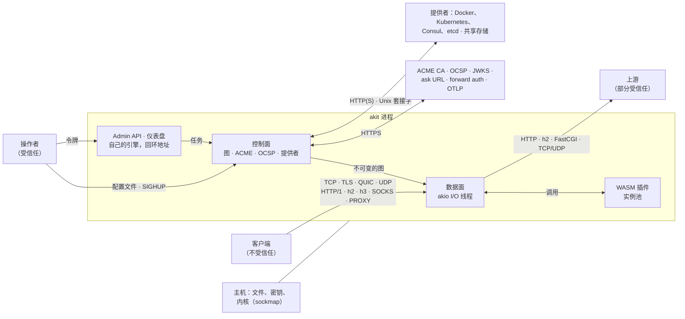

# 威胁模型

[English](threat-model.md) | [简体中文](threat-model.zh-CN.md)

akit 保护什么、防御谁、怎样防御：资产、信任边界、每个边界上的攻击以及 akit 针对它们的控制措施（守住每项措施的代码和测试），还有已知的
局限及其计划。本页为 1.0 的外部安全审查而写（[审查范围](review-scope.zh-CN.md)），并随 akit 的变化保持真实：增加边界、资产或控制措施的
改动要在同一个提交中更新本页，与[规则 26](../rules.zh-CN.md) 让两种语言同步的方式相同。如何报告问题见 [SECURITY.zh-CN.md](../../SECURITY.zh-CN.md)。

写于 I80（2026-11-26），针对 akit `main` 的 `953cb57` 加上 I80 的改动，基于 akio `0fc8f3a7`（`1.0.0-rc.1`）；由 I80b 更新
（2026-11-26，akit `main` 的 `20caeedc` 加上 I80b 的改动，akio `6bcd8ad6`），I80b 关闭了局限 L2、L3、L4、L6、L7、L12、L13 和 L14。路径相对于仓库根目录；
测试以其函数名称呼，位于所给的文件或该 crate 自己的测试中。

- [本模型中的 akit](#本模型中的-akit)
- [资产](#资产)
- [参与者与信任边界](#参与者与信任边界)
- [假设](#假设)
- [客户端](#客户端)
- [上游](#上游)
- [Admin API 与仪表盘](#admin-api-与仪表盘)
- [证书](#证书)
- [提供者与共享存储](#提供者与共享存储)
- [插件](#插件)
- [主机](#主机)
- [贯穿所有边界](#贯穿所有边界)
- [已知的局限](#已知的局限)

## 本模型中的 akit

akit 是一个进程：反向代理、TLS 终结器、静态文件服务器、四层代理、正向代理和 API 网关，由 fit 的配置驱动
（[决定 002](../decisions/002-config-compatibility.zh-CN.md)）。它的**数据面**运行在 akio 的 I/O 线程上（连接、请求、握手、转发）；
**控制面**运行在 I/O 线程之外（把配置编译成不可变的图、在自己的引擎上运行的 Admin API、提供者、ACME、OCSP、健康探测），并发布供数据面读取的
图（[架构](../architecture.zh-CN.md)）。会阻塞的工作交给有界的线程池（akio 的逻辑池、WASM 实例池、ACME 和 OCSP 的工作线程），从不放在
I/O 线程上（[规则 1](../rules.zh-CN.md)）。

发布二进制只包含 akit 和 akio 的代码（[决定 030](../decisions/030-supply-chain-checks.zh-CN.md)）：I/O、HTTP/1、HTTP/2 和 HTTP/3 的
解析、QUIC、TLS、X.509、密码算法、压缩器、正则引擎和 WebAssembly 解释器都由 akio 完成。akit 没有 `unsafe`（[规则 14](../rules.zh-CN.md)）；
akio 的 `unsafe` 被限制在少数位置并经过审查（[akio 的 unsafe 审查](https://github.com/lesismal/akio/blob/main/docs/unsafe-review.zh-CN.md)）。

## 资产

| 资产 | 所在位置 | 为什么重要 |
| --- | --- | --- |
| 所服务证书的私钥 | 密钥文件（`tls.certificates`）、证书存储（`acme.storage`、共享存储）、内存 | 冒充 akit 服务的每个站点 |
| ACME 账户密钥 | 证书存储（`acme/<ca>/account.pem`） | 为 akit 的名字签发和吊销证书 |
| Admin API 令牌 | `admin.token_file`、内存 | 完全控制配置：流量去哪里、提供什么内容 |
| akit 为其他服务持有的凭据 | 配置所指的文件：JWT 密钥、提供者和存储的令牌与密码、OTLP 头、上游客户端密钥 | 访问它们所开放的服务 |
| 运行中的配置及其历史 | 内存（`akit_admin::Configs`）、读取它的文件 | 路由、访问规则；内联写入的密钥 |
| 传输中的流量 | 套接字、akio 的缓冲区、缓存（内存层和磁盘层） | 每个请求和响应的机密性与完整性，头中的凭据 |
| 路由决定 | 图：匹配器、中间件（认证、限制、访问规则） | 绕过中间件的请求会到达不该到达的地方 |
| 可用性 | I/O 线程、连接和内存预算、线程池 | 一个客户端或上游让所有人都无法使用网关 |
| 主机 | 进程的用户、它能读取的文件、它能到达的端口 | 把 akit 当作跳板（SSRF、文件泄露） |

## 参与者与信任边界

| 参与者 | 信任 | 通过什么到达 akit |
| --- | --- | --- |
| 客户端 | 不信任：网络上的任何人 | 监听器：每个字节、握手和数据报 |
| 上游 | 部分信任：由操作者选择，但其应答作为不受信任的输入解析，可能很慢或已被攻破 | 代理、FastCGI 和四层的连接 |
| 操作者 | 信任：编写配置、其文件和环境 | 配置文件、SIGHUP、带令牌的 Admin API |
| 本机进程 | 不信任，除非操作者给了它们令牌或 Unix 套接字 | Admin API 的回环地址或套接字 |
| 操作者浏览器中的网页 | 不信任 | 经由浏览器访问 Admin API（CSRF、DNS 重绑定） |
| 提供者和共享存储 | 对它们可以修改的内容信任，作为解析器的输入不信任 | 它们的 API，由 akit 调用 |
| akit 调用的远程服务（ACME CA、OCSP 响应者、JWKS、ask URL、forward auth、OTLP 收集器） | 信任其应答的含义，作为输入不信任 | akio 的 HTTP 客户端 |
| 插件模块 | 信任它是操作者的选择，作为代码加以限制 | 实例池及其宿主函数 |

## 假设

- **配置是受信任的。** 能写入 akit 的配置、其文件或环境的人就控制了 akit：可以代理到任何地方、提供进程能读取的任何文件、加载插件、设置
  每项限制。Admin API 拥有同样的权力，由其地址和令牌守护。
- **主机是受信任的**，以进程的用户为限：它的文件权限、内核、时钟和 CA 证书集（`akio::tls::RootCerts::system`）。
- **上游回答操作者让它们回答的内容**，但 akit 不让上游的应答破坏客户端的连接、分帧或其他请求。
- **在本模型中 akio 是正确的**；它自己的威胁属于 akio（[akio 的政策](https://github.com/lesismal/akio/blob/main/SECURITY.zh-CN.md)），
  审查范围说明外部审查会看 akio 的哪些部分。

## 客户端

### 解析、分帧与请求走私

| 攻击 | 控制措施 | 测试 |
| --- | --- | --- |
| HTTP/1.1 请求走私：`Content-Length` 与 `Transfer-Encoding` 并存、两个长度、chunked 以外的编码、错误的块大小、过时的折行 | akio-http 的解析器在处理器运行前拒绝每一种（400，不认识的编码 501；akio API 需求 A169）；代理向上游写自己的分帧，丢弃客户端的 `Content-Length`、`Transfer-Encoding` 和 `TE`（`crates/akit-proxy/src/headers.rs`，`request_field`） | `crates/akit/tests/conformance.rs`：`h1_smuggling_with_content_length_and_transfer_encoding`、`h1_bad_requests_get_400_and_reach_nothing`、`h1_a_bad_chunk_size`、`h1_obs_fold` |
| 畸形的 HTTP/2 和 HTTP/3 请求：伪头、连接专用字段、与消息体不符的长度 | akio 的 h2 和 h3 服务器（A169）；代理丢弃伪头和逐跳字段 | `h2_malformed_requests_are_refused_and_reach_nothing`、`h2_content_length_that_disagrees_with_the_body`（conformance）；h2spec（I25） |
| 缺少或重复的 `Host`；绝对形式的请求目标 | akio 拒绝 HTTP/1.1 上缺少或重复的 `Host`（400）；代理拒绝两个 `Host` 字段（`headers.rs`，`Refused`）；绝对形式的目标按其路径路由，并以 origin 形式发往上游（`crates/akit-proxy/src/lib.rs`，`origin_form`；I77） | `h1_absolute_form_target`、`refused_field_values_and_two_hosts` |
| 到达不该到达的路由的路径：点段、`%2E`、`//`、用 `%2F` 和 `%5C` 隐藏的段、无法解码的转义 | 每个请求路径在路由前规范化（`crates/akit-router/src/path.rs`，`canonicalize`），无法规范化的由监听器以 400 拒绝：因此路由、`strip_prefix` 和静态处理器看到的是同一个路径 | `fits_canonicalize`、`non_utf8_escapes`（`path.rs`）；`canonical_path`（`crates/akit-proxy/tests/proxy.rs`）；模糊测试目标 `router_path`、`router_find` |
| akit 自己的解析器遇到恶意输入：表达式、JWT、Basic 凭据、`Accept-Encoding`、`Forwarded`、`grpc-timeout`、缓存指令、按 ClientHello 路由、PROXY 头（akio-mux 的） | 对端输入不会引发 panic（[规则 15](../rules.zh-CN.md)：非测试代码中 Clippy 禁止 `unwrap`、`expect`、索引和未检查的算术，CI 使用 `-D warnings`）；每个解析器都做模糊测试 | I77 的目标（`fuzz/`），其语料由 `cargo test` 回放；akio 为自己的解析器设的目标 |

### 资源耗尽

| 攻击 | 控制措施 | 测试 |
| --- | --- | --- |
| 连接过多 | `limits.max_conns`（100,000，全进程）作为 akio 的 `max_connections`；四层的 `services[].max_conns`；Admin API 的 16 | `connection_limit`（`crates/akit-listener/tests/limits.rs`）、`tcp_max_conns`（`l4.rs`） |
| 慢速客户端（slowloris）：一次一个字节地发送头、停滞的消息体、从不读完的读取 | akio-http：头在第一个字节后 10 秒内到齐（408），消息体 60 秒没有字节；keep-alive 空闲 120 秒（`CLIENT_IDLE_TIMEOUT`，与 fit 相同）；停止读取的客户端由 `limits.write_stall_timeout`（30 秒）处理；`limits.max_write_queue_bytes`（32 MiB） | `client_idle_timeout_is_fits`、`write_stall_timeout`；每个功能测试中的慢速和中途断开的客户端（[规则 18](../rules.zh-CN.md)），例如 `clients_cut_and_slow`（WASM）、`slow_peers_and_cut`（CONNECT） |
| 大的头和消息体 | `limits.max_header_bytes`（1 MiB：431，以及 HTTP/2 和 HTTP/3 的头列表限制）、`limits.max_body_bytes`（16 MiB：在处理器之前根据 `Content-Length` 或在到达时返回 413）、路由的 `body_limit`；消息体流式处理，除非功能需要，否则从不整体缓冲，需要时也有上限（[规则 7](../rules.zh-CN.md)） | `header_limit`、`header_limit_default`；`body_limit`（`crates/akit-proxy/tests/proxy.rs`）；`h1_a_header_past_the_limit` |
| HTTP/2 控制帧、重置和 QUIC 包的洪泛 | akio 的预算（HTTP/2 重置和洪泛预算、QUIC 限制） | akio 的测试 |
| 以客户端输入为键、无界增长的表 | 每张表都有上限（[规则 11](../rules.zh-CN.md)）：`rate_limit`（`max_keys` 100,000，64 个分片，抽样淘汰，头作为键时用带密钥的 SipHash：`crates/akit-middleware/src/limit.rs`）、basic auth 同时进行的校验（1,024）、按需 TLS 的名字和拒绝记录、缓存的 zone | `rate_limit`、`rate_limit_by_header`、`captures_are_bounded`、`max_names` |
| 每个请求都被迫做昂贵的工作：bcrypt、JWT 签名、WASM 调用、缓存填充 | bcrypt 在 akio 的线程池上运行，最多同时 1,024 个，校验通过后以 HMAC 记住；JWT 签名每个令牌校验一次并保留；WASM 在有界的线程池上运行，队列有界（满时 503）；缓存锁（雪崩时只填充一次） | `basic_auth_checks_off_the_io_thread`、`never_blocks`、`wait_timeout` |
| I/O 线程被阻塞或 panic | I/O 线程上没有会阻塞的操作（[规则 1](../rules.zh-CN.md)；每次测试运行都开启 akio 的慢回调检测器）；对端输入不会引发 panic（见上） | 每个 crate 在检测器下运行的测试 |

### 绕过路由的检查

| 攻击 | 控制措施 | 测试 |
| --- | --- | --- |
| 伪造客户端地址：客户端发送的 `X-Forwarded-For`、`Forwarded`、`X-Forwarded-Proto`、`X-Forwarded-Host` | 来自 `trusted_proxies` 之外对端（默认没有受信任的代理）的这些字段都被丢弃，并根据连接重建（`headers.rs`，`outgoing`、`is_trusted`）；`rate_limit` 和 `remote_ip` 只读取受信任对端的 `X-Forwarded-For`（`limit.rs`，`client_ip`） | `forwarded_untrusted`、`forwarded_trusted`、`trusted_forwarding`、`client_ips`；模糊测试 `proxy_headers`、`middleware_fields` |
| 伪造的 PROXY protocol 头 | 只解析来自 `proxy_protocol.trusted` 对端的头，10 秒和 4,096 字节以内；其他对端的这些字节属于数据流，从不被当作地址 | `proxy_protocol_http`（`crates/akit-proxy/tests/proxy_protocol.rs`）、`proxy_header_names_the_client`（`socks.rs`）、`client_proxy_header_stays_in_userspace`（`sockmap.rs`） |
| 向上游请求注入头：值中的 CR、LF 或 NUL，客户端发送字段冒充认证结果（`jwt` 的 `X-User`、`forward_auth` 的 `copy_headers`） | 拒绝含 NUL、CR 或 LF 的值和错误的字段名（`headers.rs`，`Refused`）；客户端发送的与声明头或 forward auth 头相同的字段（`_` 或 `-` 的任何写法）在 akit 设置之前被移除（`jwt.rs`、`forward.rs`，`same_field`） | `refused_field_names`、`refused_field_values_and_two_hosts`、`jwt_claims_headers`、`forward_auth_request_headers`、`same_fields` |
| Basic auth：猜测、计时 | 只接受 bcrypt 哈希（`password_hash`）；未知用户与一个诱饵哈希比较，计时无法区分用户；记住的 HMAC 以常数时间比较；除非 `forward_authorization`，否则不转发 `Authorization` | `basic_auth`、`basic_auth_forward_authorization` |
| JWT：`alg: none`、算法混淆（用公钥做 HMAC 校验）、`crit`、过期令牌、弱密钥 | 从不接受 `none` 和 `crit`；算法限于 `allowed`，并与其密钥类型绑定（`jws.rs`，`Key::fits`），HMAC 密钥只来自配置的密钥文件（至少 32 字节），从不来自 JWK；拒绝小于 2,048 位的 RSA；要求 `exp`，`nbf` 带宽限检查；令牌最多 16 KiB；HMAC 以常数时间比较 | `jwt_algorithms`、`jwt_claims`、`claims_checked`；模糊测试 `jwt_token`、`jwks_keys` |
| 客户端证书 | 依据监听器的 CA 文件进行 `tls.client_auth`（默认 `require`，或 `verify_if_given`）；按路由的 `client_cert`；CA 文件变化会重新打开监听器 | `client_auth_require_and_verify_if_given`、`client_auth_over_h3`、`client_cert`、`new_client_authorities_reopen_the_listener` |
| 缓存投毒和泄露：给一个用户的响应被返回给另一个用户，键忽略了上游读取的内容 | 键是 scheme、host 和请求目标（`crates/akit-cache/src/cache.rs`，`key_of`）；遵循 `Vary`；不存储：`no-store`、`private`、`no-cache`（会重新验证）、`Vary: *`、`Set-Cookie`、`Content-Range`；带 `Authorization` 的请求或带认证中间件的路由，只有在响应允许共享缓存时才存储（`public`、`s-maxage`、`must-revalidate`）；不受信任对端的转发头根据连接重建，因此无法在暗中改变应答 | `vary`、`authenticated_not_shared`、`storable`；模糊测试 `cache_semantics` |

### 文件、FastCGI 与正向代理

| 攻击 | 控制措施 | 测试 |
| --- | --- | --- |
| `static` 中的路径穿越：`..`、NUL、反斜杠，无论是否转义；点文件 | 先是规范化路径（见上），然后处理器自己的扫描拒绝 `..`、NUL 和 `\`（400：`crates/akit-handler/src/static_files.rs`，`scan`）；默认 `dotfiles: deny`（除 `/.well-known` 外返回 404），`try_files` 的候选也一样；只在 akio 的线程池上打开普通文件；目录列表做 HTML 转义；根目录下的符号链接无论指向何处都会被跟随，与 fit 相同（L7，参考文档中写明） | `traversal`、`browse`、`symlinks_out_of_the_root_followed`（`crates/akit-handler/tests/static_files.rs`）、`traversal_is_unsafe`、`dotfiles_are_hidden`；模糊测试 `static_path` |
| FastCGI：根目录之外的脚本、httpoxy | `SCRIPT_FILENAME` 由清理过的路径拼接在根目录之下，拒绝 `..`、NUL 和 `\`，隐藏点文件（`crates/akit-handler/src/fastcgi/params.rs`、`crates/akit-config/src/fastcgi.rs`）；客户端的 `Proxy` 字段从不变成 `HTTP_PROXY` | `params`、`dotfiles`、`fields`、`cleans`；模糊测试 `fastcgi_paths`、`fastcgi_response` |
| 利用正向代理（SOCKS、CONNECT）访问内部服务（SSRF）、DNS 重绑定 | 必须设置 `clients`；目的地在拨号前根据 `allow`、`deny` 和 `ports` 检查，连接后再按实际连接的地址检查一次（`crates/akit-l4/src/forward.rs`）；回环、链路本地（云元数据）、未指定、组播地址和主机自己的地址被拒绝，除非 `allow` 写明，IPv4 映射地址先解除映射；拒绝 SOCKS 的 BIND 和 UDP ASSOCIATE | `rules_dest`、`rules_internal`、`netguard_internal_and_refused`、`tunnels_and_refusals`、`refusals`；模糊测试 `l4_forward` |

### 来自客户端的 TLS

| 攻击 | 控制措施 | 测试 |
| --- | --- | --- |
| 降级、弱密码套件 | 只有 TLS 1.2 和 1.3（`max_version` 可以把上限降到 1.2，从不降低下限）；akio 的套件：只有 ECDHE 搭配 AES-GCM 或 ChaCha20-Poly1305，没有 CBC，没有 RSA 密钥交换；HTTP/3 只用 TLS 1.3（`crates/akit-tls/src/lib.rs`，`server_configs`） | `alpn_follows_the_listeners_protocols`；akio 的 TLS 测试 |
| 0-RTT 重放 | early data 关闭：akio 的 `max_early_data` 为 0，akit 从不开启 | —（没有相应代码路径） |
| SNI：akit 没有证书的名字 | 与 fit 相同，返回第一张证书（`crates/akit-tls/src/certs.rs`，`choose`）；在 HTTP 上按 `Host` 而不是 SNI 路由 | `chooses_as_fit`、`sni_picks_the_certificate` |
| ACME TLS-ALPN-01 证书被返回给客户端 | 只返回给只提供 `acme-tls/1` 的 ClientHello，且名字正在验证中；这样的连接在握手后关闭 | `tls_alpn_challenges_as_fit`、`acme_tls_connections_serve_nothing` |
| 利用按需 TLS 让 akit 为任意名字申请证书（CA 速率限制、存储） | `tls.on_demand` 需要带 `ask` URL 的 `acme.on_demand`（否则拒绝）；询问前检查名字（字母、数字、连字符、一个点，不能是地址）；询问有上限（同时 8 个，每 200 毫秒一个，突发 20 个），拒绝记住一分钟（最多 10,000 个），签发按每 `interval` `rate` 个（每分钟 10 个）和 `max_names`（1,000），等待者有上限（每个名字 1,024）；握手等待时不占住 I/O 线程 | `obtains_a_certificate_during_the_handshake`、`a_name_past_the_rate_fails_at_once`、`refused`、`rate_limited`、`max_names`、`ask_bounds`、`https_ask`、`on_demand_names_as_fit` |

### 四层与 sockmap 转发

| 攻击 | 控制措施 | 测试 |
| --- | --- | --- |
| 空闲或慢速的转发占用资源 | `services[]` 的空闲超时、`max_conns`、双向联动的背压；在 sockmap 路径上，空闲时间从套接字的 TCP 计数器读取 | `tcp_idle_timeout`、`udp_sessions_expire`、`slow_client_gets_everything`、`idle_timeout_from_counters` |
| eBPF 转发绕过检查 | 只在上游连接后为普通 `tcp` 服务拼接：终结 TLS 时从不拼接，客户端发送了 PROXY 头时从不拼接，超过 akio 的 16,384 对时从不拼接；转发程序加载失败（权限、6.15 之前的内核）时回退到用户态，字节和超时相同（[决定 010](../decisions/010-sockmap-relay.zh-CN.md)） | `splices_and_echoes`、`client_end_forwards_everything`、`upstream_end_forwards_everything`、`sni_passthrough_spliced`、`proxy_header_goes_first` |

## 上游

| 攻击 | 控制措施 | 测试 |
| --- | --- | --- |
| 破坏客户端分帧的响应：逐跳字段、`Connection` 中列出的字段、错误的 `Content-Length` | 代理从响应中丢弃逐跳字段和 `Connection` 中列出的字段（`headers.rs`，`incoming`），自己为客户端的响应分帧；akio 的客户端把上游当作不受信任的输入解析 | `hop_by_hop_response`、`h1_connection_specific_fields_from_the_upstream_are_dropped`、`response_fields` |
| 慢速或无应答的上游 | 连接超时、`response_header_timeout`、`response_idle_timeout`、`response_timeout` 和路由的 `timeout`（504）；客户端离开时放弃上游请求；被动和主动健康检查；熔断器；带预算的重试 | `connect_timeout`、`timeout_before_head`、`response_header_timeout`、`response_idle_timeout`、`cut_short_mid_body`、`client_abort`（`crates/akit-proxy/tests/failure.rs`）；`crates/akit-proxy/tests/retry.rs` |
| 很大或没有尽头的响应 | 流式处理并联动背压（`hold_reads` / `on_drain`），从不整体缓冲；缓存和镜像有各自的限制 | `stream_download`、`stream_upload`、`stream_download_from_h2c`（`crates/akit-proxy/tests/stream.rs`，客户端慢速读取时内存有界） |
| 网络上被冒充的上游（基于 TLS 的 h2） | 始终验证，依据系统的 CA 或 `tls_ca_file`；没有跳过验证的选项；`tls_server_name`；配置时使用客户端证书（`crates/akit-tls/src/upstream.rs`） | `client_certificate`、`server_name`、`http1_fallback_keeps_the_name_and_the_certificate`（`crates/akit-proxy/tests/upstream_tls.rs`） |
| FastCGI 应用的应答 | 在限制之内读取记录，CGI 头作为不受信任的输入解析（`fastcgi/record.rs`、`exchange.rs`） | `timeouts_and_limits`；模糊测试 `fastcgi_response` |

明文 HTTP 和 h2c 上游的可信程度与 akit 和它们之间的网络相同：这是操作者的选择，与 fit 一样。

## Admin API 与仪表盘

| 攻击 | 控制措施 | 测试 |
| --- | --- | --- |
| 从网络访问 | 不设置 `admin` 就不开启；地址必须是回环地址或以 0600 权限创建的 Unix 套接字，除非有令牌和 TLS（I92：`cert_file`、`key_file`，以及在握手中验证客户端证书的 `client_ca_file`；否则为配置错误：`crates/akit-config/src/model.rs`，`admin`）；运行在自己的引擎上，繁忙的数据面不会拖住它（[决定 006](../decisions/006-admin-api.zh-CN.md)） | `refused`、`defaults_and_values`（`crates/akit-config/tests/admin.rs`）、`unix_socket`、`tls`、`tls_client_ca`、`tls_start_errors` |
| 本机的其他用户或进程 | `token_file`：除仪表盘的静态文件外，每个请求都要带 bearer 令牌，以常数时间比较（`crates/akit-admin/src/server.rs`，`guard`、`same`）；组或其他用户可读的令牌文件会被警告（见下文的主机） | `token`、`tokens_compared`、`dashboard_token`、`edits_dry_runs_and_rollbacks_behind_the_token`、`cache_purge_guarded` |
| 操作者浏览器中的网页（CSRF、DNS 重绑定） | 带 `Origin` 的请求都被拒绝（403），来自 API 自身来源的读取除外；没有令牌时，`Host` 必须是回环主机名，因此重绑定的名字被拒绝 | `browsers_refused`、`loopback_hosts`、`cache_purge_guarded` |
| 经 API 读到内联的秘密（持有令牌的人、仪表盘、记录其应答的日志） | 每次读取配置（`/config` 及其指针、`/versions/{n}`、`/config/effective`），凡 fit 的 `secretName` 认定为秘密的成员下的字符串都答 `[redacted]`（`crates/akit-admin/src/redact.rs`）；修改送回的 `[redacted]` 保留原位置的秘密，其位置上没有秘密的被拒绝（400）；`ETag` 仍是配置的（[决定 035](../decisions/035-admin-api-redacts-secrets.zh-CN.md)） | `secrets_redacted`、`redacts_secrets_only`、`redacts_under_a_pointer`、`restores_by_member_name_and_index` |
| 大的或慢速的请求 | 配置的消息体在 `max_config_bytes`（4 MiB：413）之内流式读取，其他消息体在 64 KiB 之内；头 10 秒，消息体 60 秒没有字节，空闲 60 秒；`max_conns`（16）；只有 HTTP/1.1 | `loads_refused`、`edit_limits_and_cut_clients`、`slow_and_cut_clients`、`connection_limit` |
| 破坏运行中网关的修改、丢失的更新 | 每个修改在应用前都要编译（编译失败的被拒绝，保留运行中的配置）；`?dry_run=1` 只编译不应用；`If-Match` 在为应用排序的锁下比较（412）；历史记录和回滚 | `dry_run`、`dry_run_removes_listener`、`if_match_every_change`、`concurrent_writers`、`rollback` |
| 利用仪表盘进行 XSS 或点击劫持 | 只有自己的文件，只读，带 `Content-Security-Policy: default-src 'none'; script-src 'self'; connect-src 'self'; frame-ancestors 'none'`、`X-Frame-Options: DENY`、`nosniff`、`Referrer-Policy: no-referrer`；令牌保存在 `sessionStorage` 中 | `dashboard`、`dashboard_read_only`、`the_dashboard_and_the_status` |
| 提供者改写 Admin API 或其他控制面设置 | 提供者的部分只能包含 `listeners`、`routes`、`upstreams` 和 `services`；两者都定义的名字以基础配置为准（`crates/akit-provider/src/merge.rs`） | `parts_refused`、`parts_refused_more`、`merges` |

### 控制台

控制台（`admin.console`，I89–I91，[决定 036](../decisions/036-console.zh-CN.md)）在登录之后提供 Admin API 的端点和 fit 的工作台页面。

| 攻击 | 控制措施 | 测试 |
| --- | --- | --- |
| 从网络访问，密码在途中被读取 | 不设置 `admin.console` 就不开启；非回环地址必须有 `cert_file` 和 `key_file`（否则为配置错误）；`admin.console.access`、再是全局访问控制，在 accept 时决定 | `console_refused`（`crates/akit-config/tests/admin.rs`）、`over_tls`、`access_at_accept`、`console_under_akit_run` |
| 猜测密码 | 只有 bcrypt 哈希（配置中没有明文）；不是用户的名字用假哈希检查；同时检查 2 个，在自己的池上（1 个线程、16 个等待，再多 503），从不在 I/O 线程上；一个地址（IPv6 按 /64）15 分钟内失败 5 次即锁定 15 分钟，加倍直到一小时，一个地址同一时间只检查一个，最多记录 4,096 个地址；一个用户连续失败 10 次后其检查从 2 秒延缓到 5 分钟（`crates/akit-admin/src/console/login.rs`） | `lockout`、`admit_attack`、`admit_full_table`、`user_backoff`、`address_backoff`、`logins_refused` |
| 被盗或重放的会话 | `HttpOnly`、`SameSite=Strict`（TLS 上 `Secure`）cookie 中的 32 个随机字节，按 SHA-256 保存；空闲（30 分钟）、超过总时长（12 小时）、登出或超过 `max_sessions` 作为最旧者时结束；只在内存中 | `sessions`、`sessions_end` |
| 操作者浏览器中的网页（CSRF、点击劫持、XSS） | 除读取外的每个请求在 `X-Fit-Csrf` 中带会话的 CSRF 令牌（常数时间比较）；`Origin` 不是控制台的请求被拒绝；只允许页面自身文件和来源的 Content-Security-Policy、`frame-ancestors 'none'`、`X-Frame-Options: DENY`、`nosniff`、`Referrer-Policy: no-referrer`，TLS 上 HSTS；API 的回答带 `Cache-Control: no-store` | `login_and_edit`、`pages_and_schema`、`over_tls` |
| 未登录而占用连接 | `max_conns` 在 accept 时限制；请求头 10 秒、请求体 30 秒、空闲 2 分钟；对没有有效会话的回答会关闭连接。fit 的 5 秒限制和驱逐等待 akio 的 A232 | `login_and_edit` |
| 谁改了什么 | `admin` 日志记录器：登录及其来源、失败、登出、每次修改及其应用的版本；控制台的配置以 `console` 为来源记入 `/versions` | `login_and_edit`、`console_under_akit_run` |

## 证书

文件、ACME、按需 TLS 和 OCSP。

| 攻击 | 控制措施 | 测试 |
| --- | --- | --- |
| 证书与密钥不匹配，文件在写入中途被替换 | 加载时检查每一对（`load_pair`）；文件最多 1 MiB；`-watch-certs` 等文件稳定后重载，不匹配的一对保留运行中的配置 | `problems_name_the_certificate_or_file`、`reloads_once_the_files_settle`、`a_certificate_replaced_under_traffic` |
| 从存储中泄露密钥 | 文件存储以 0700 创建目录、以 0600 创建文件（`create_new`），先写入临时名、同步再重命名，重命名后同步目录；其根目录及其下被写入的目录若对其他人开放，收紧为 0700（`FileStorage::prepare`）；配置中写的是密钥文件的路径，因此 Admin API 的应答只含路径，不含密钥，组或其他用户可读的密钥文件会被警告（`crates/akit-config/src/hardening.rs`） | `stores_loads_lists_and_deletes`（检查模式）、`an_open_storage_directory_is_tightened`、`secret_files_open_to_others`、`validate_warns_of_exposed_secrets` |
| 存储键中的路径花招 | 会离开存储根目录的键被拒绝（`crates/akit-tls/src/storage.rs`） | `crates/akit-tls/tests/storage.rs` |
| 滥用 HTTP-01 应答 | 只在明文监听器上、路由之前，为 CA 给出的令牌（base64url）应答；应答本来就是公开的；在共享存储中的查找有上限（同时 16 个，每个客户端 4 个，5 秒） | `obtains_serves_and_keeps_a_certificate`（对 Pebble 的 HTTP-01）、`a_challenge_nobody_has_is_404` |
| 恶意或慢速的 CA、OCSP 响应者、ask URL | 各自在自己的引擎和工作线程上运行，不在 I/O 线程上；应答有上限（ACME 1 MiB，OCSP 和 ask 64 KiB），有超时（每个请求 30 秒，每个订单 600 秒，OCSP 和 ask 10 秒），访问 CA 和 OCSP 不跟随重定向，退避从 60 秒到一小时；OCSP 响应依据签发者验证、与证书匹配，从不在 `nextUpdate` 之后装订；来自文件的证书，只有其链验证通过且响应者在公网地址时才询问其响应者 | `a_slow_responder_is_bounded`、`refreshes_keeps_and_drops_responses`、`certificates_from_files_not_trusted_are_not_asked`、`responders_of_files_at_private_addresses_are_not_asked`、`stapled_in_a_handshake`、`renews_when_ari_says` |

## 提供者与共享存储

| 攻击 | 控制措施 | 测试 |
| --- | --- | --- |
| 提供者的 API 发送巨大或恶意的文档 | 每个应答都有上限（Docker：列表 16 MiB，事件 1 MiB；Consul 和 etcd：32 MiB；Kubernetes：每页 64 MiB，令牌文件 64 KiB），对象有计数（`max_containers` 1,000，`max_services` 和 `max_keys` 1,000，`max_objects` 10,000）；部分最多 16 MiB；由 akit 自己的读取器解析，并做模糊测试 | `list_fails`、`bad_events`、`catalog_max_services`、`provider_max_keys`；模糊测试 `provider_docker`、`provider_kubernetes`、`provider_consul`、`provider_kv`、`provider_merge` |
| 提供者接管网关 | 部分限于四类，以基础配置为准（见上）；提供者的修改作为版本应用，与其他修改一样先编译 | `providers`、`file_and_providers`（`crates/akit-admin/tests/providers.rs`） |
| 滥用 Kubernetes 凭据 | 集群内：服务账户的令牌，必须有集群 CA，强制 `https`；拒绝 kubeconfig 的 `exec` 和 auth-provider 插件（不运行任何命令）；令牌每分钟重新读取；kubeconfig 中不在环回上的 `http://` 服务器或 `insecure-skip-tls-verify` 在 provider 的日志中警告（`RestConfig::exposed`） | `kubeconfigs`、`token_rotates`、`cert_files` |
| 共享证书存储（Redis、etcd、Consul） | 凭据来自文件；TLS 使用系统的 CA 或 `ca_file`；锁带租约（崩溃实例的锁会过期）；应答在限制之内解析；不在环回上明文访问的存储，以及这样发送的 provider 令牌或密码，会被警告（`crates/akit-config/src/hardening.rs`，`cleartext`） | `redis_shares_keys_and_locks`、`etcd_shares_keys_and_locks`、`consul_shares_keys_and_locks`、`credentials_in_the_clear`；模糊测试 `tls_redis_reply` |

提供者可以增加监听器（Consul KV、etcd、Kubernetes）：能写入提供者数据源的人可以打开端口、路由流量，与 fit 相同。这是操作者给予数据源的信任。

## 插件

| 攻击 | 控制措施 | 测试 |
| --- | --- | --- |
| 插件逃出沙箱 | akio-wasm 是解释器（不生成机器码，没有 `unsafe`，[决定 008](../decisions/008-wasm-runtime.zh-CN.md)）；插件只能访问自己的内存和被授予的宿主函数：fit 的 ABI（`header_get`、`header_set`、`header_add`、`header_del`、`request_get`、`respond`、`log`）和 Proxy-Wasm 的子集（[决定 011](../decisions/011-proxy-wasm.zh-CN.md)）；WASI 没有参数、环境变量、文件和套接字；Proxy-Wasm 的外部调用、共享数据、队列和外部函数返回 `Unimplemented`，因此插件没有网络 | `calls`、`errors`、`close_context_traps`、`load_errors` |
| 插件无限运行或耗尽内存 | 每次调用有截止时间（`timeout`，100 毫秒，超过即陷入），`max_memory_bytes`（128 MiB，最多 4 GiB），`instances`（最多 1,024），有界队列（`queue`，满时 503，`wait_timeout` 1 秒），`max_streams`，`max_body_bytes`（1 MiB）；陷入后重新创建实例 | `failures`、`never_blocks`、`wait_timeout`、`max_streams`、`max_body_bytes` |
| 插件破坏 akit 发出的内容 | 字段名必须是 token，值不含 CR、LF 或 NUL，`:path` 必须是路径；每个头映射最多 1,024 处修改，最多 256 个指标；本地响应的消息体最多 1 MiB，日志行 64 KiB | `headers`、`respond`、`routing`、`properties`；模糊测试 `plugin_pairs` |
| 插件阻塞 I/O 线程 | 插件从不在 I/O 线程上运行：请求在其调用等待和运行于线程池期间挂起 | `never_blocks`、`clients_cut_and_slow` |
| 恶意的模块文件 | 在编译配置时读取，最多 64 MiB，运行前由 akio-wasm 验证 | `reading_is_bounded` |

## 主机

| 攻击 | 控制措施 | 测试 |
| --- | --- | --- |
| 滥用 akit 的权限 | systemd unit 以 `akit` 用户运行 akit，只有 `CAP_NET_BIND_SERVICE`（ambient 和 bounding 集合）并设置 `NoNewPrivileges`（`deploy/systemd/akit.service`，[决定 009](../decisions/009-packaging.zh-CN.md)）；镜像以 distroless 的 `nonroot` 用户运行；sockmap 转发的 `CAP_BPF` 和 `CAP_NET_ADMIN` 只在监听器要求时才需要，akit 没有它们也能运行 | `deploy/systemd/test.sh`（CI 的打包任务） |
| 通过配置读取文件 | 配置是受信任的（见假设）；对端给出的文件名从不受信任：静态文件和 FastCGI 的路径保持在其根目录之下 | 见上 |
| 本机其他用户能读取的秘密文件 | 配置为密钥、令牌或密码指定的文件（`key_file`、`tls_key_file`、`token_file`、`password_file`、`hmac_secret_file`、`kubeconfig`），其组或其他用户有任何权限时，在启动时、`akit validate` 中和每次修改时警告，与 fit 一样照常运行（`crates/akit-config/src/hardening.rs`，`secret_files`） | `secret_files_open_to_others`、`validate_warns_of_exposed_secrets` |
| 环境变量和参数 | 只有 `.conf` 配置会展开 `{$NAME}`；akit 从对端读取的内容不会到达 shell（akit 不运行任何命令） | — |

## 贯穿所有边界

- **内存安全**：akit 没有 `unsafe`（每个 crate 都是 `#![forbid(unsafe_code)]`，工作区设置 `unsafe_code = "forbid"`）。akio 的 `unsafe`
  限于 `akio-sys`、`akio-uring` 和 `akio-ebpf` 的 `sys`，每处都写明其不变量，经过审查，并在 akio 中由 Miri、sanitizer 和模糊测试检查。
- **Panic**：对端或配置的输入不会引发 panic（[规则 15](../rules.zh-CN.md)）；在测试之外 Clippy 禁止 `unwrap`、`expect`、`panic`、
  索引和未检查的算术，其余由模糊测试搜寻。
- **供应链**：发布二进制只链接 akio，按提交固定；cargo-deny 和 cargo-audit 在每次改动和每天运行，注册表 crate 进入二进制时
  `tools/release-deps.py` 会失败（[决定 030](../decisions/030-supply-chain-checks.zh-CN.md)）。
- **日志**：每种访问日志格式都对客户端控制的字段做转义（JSON 字符串、logfmt、Go 引号：`crates/akit-observe/src/format.rs`），请求
  无法伪造日志行；由 `json_strings`、`logfmt_values` 和模糊测试 `observe_access_log`、`observe_escapes` 检查。

## 已知的局限

每一项都是审查应当事先知道而不是去发现的缺口，并写明在哪里解决。计划中的 [I80b](../dev-plan.zh-CN.md#i80b-安全加固) 负责属于 akit 的
各项，审查的发现陆续加入；其余属于 1.0 之后的某条路线、fit 或 akio。控制台路线（2026-11-26）关闭了 L1，L5 仍为接受。I80b（2026-11-26）关闭了 L2、L3、L4、L6、L7、L12、L13 和 L14
（[决定 035](../decisions/035-admin-api-redacts-secrets.zh-CN.md)）；L8 和 L9 等待 fit 的配置增加字段，L15 等待 akio 的外部审查。

| 编号 | 局限 | 暴露面 | 计划 |
| --- | --- | --- | --- |
| L1 | 已关闭（控制台路线）。Admin API 不提供 TLS，只监听回环地址或 Unix 套接字 | 未知：Admin API 在非回环地址上带令牌经 TLS 提供，用 `client_ca_file` 要求客户端证书（I92），控制台经 TLS 带登录提供（I90）；API 和控制台的证书文件在 akit 启动时读取 | 已完成：`tls`、`tls_client_ca`、`over_tls` |
| L2 | 已关闭（I80b）。`GET /config`、`/versions/{n}` 和 `/config/effective` 曾按写入的样子返回配置，包括内联的值（`password_hash`、路由设置的头的值） | 未知：每次读取时，fit 的 `secretName` 认定为秘密的成员下的字符串都答 `[redacted]`；修改中送回的 `[redacted]` 保留秘密。成员名不表明秘密的（如 `X-Api-Key` 头）按写入的样子返回 | 已完成：`crates/akit-admin/src/redact.rs`，`secrets_redacted` |
| L3 | 已关闭（I80b）。读取密钥和私钥文件时曾不检查其权限；已有的、权限更宽的存储目录曾照原样使用；存储曾在重命名后不同步目录 | 对他人开放的秘密文件会被警告，但不拒绝（与 fit 一样读取） | 已完成：`secret_files` 警告，存储的目录收紧为 0700 并同步（`an_open_storage_directory_is_tightened`、`secret_files_open_to_others`） |
| L4 | 已关闭（I80b），以警告的方式。允许明文的控制面传输：`http://` 的 ACME 目录，经 `http://` 带令牌访问 Consul、etcd 和共享存储，不带 TLS 的 Redis（其默认），`tcp://` 的 Docker，kubeconfig 的 `insecure-skip-tls-verify` 以及带 bearer 令牌的 `http://` 服务器 | 按操作者的配置，凭据和证书在路径上可被读取，现在不在环回上时会被警告 | 已完成：`cleartext` 和 Kubernetes provider 的 `exposed`（`credentials_in_the_clear`、`kubeconfigs`）；是否拒绝由 fit 决定 |
| L5 | 私钥和 ACME 账户密钥未加密存储，无论是文件还是共享存储；存储中的证书按存储所保存的样子被信任 | 能读取存储的人就持有密钥（与 fit、Caddy、certmagic 相同） | 随控制台路线重新审视（决定 036）：接受。fit 的加密 store 保存配置和控制台用户，不保存证书存储，而 akit 与 fit 共用证书存储（I62）；store 本身等待 akio 的 A230 和 A231（I93） |
| L6 | 正向代理没有代理认证（SOCKS5 不带认证方法，CONNECT 不带 `Proxy-Authorization`），私有地址段（10/8、172.16/12、192.168/16、100.64/10、fc00::/7）除非 `deny` 列出否则可达，与 fit 相同 | `clients` 范围宽的正向代理能到达内部网络 | 已在参考文档的 `forward_proxy` 中写明（I80b）；访问控制列表已实现（I85–I87：监听器、其服务以及 SOCKS 客户端请求上的 `access`），运维者可以拒绝私有网段；代理认证在 1.0 之后 |
| L7 | 已决定（I80b）：静态文件跟随符号链接，包括根目录内指向根目录外的链接，与 fit 的 `static` 有意的行为相同（fit 没有选项） | 能在根目录下创建链接的人可以提供链接所指的内容 | 已在参考文档的 `static` 中写明；有测试（`symlinks_out_of_the_root_followed`）；拒绝它们的选项要先在 fit 中设计（[决定 035](../decisions/035-admin-api-redacts-secrets.zh-CN.md)） |
| L8 | 不检查客户端证书是否被吊销（没有 CRL，没有 OCSP） | 被吊销的客户端证书在过期前都会被接受 | akio-tls 已具备（`ServerConfigBuilder::client_crls`、`client_ocsp_policy`）；fit 的配置没有字段：已向 fit 提议 `tls.client_auth.crl_files`（决定 035），fit 有了之后 akit 读取它 |
| L9 | WASM 模块不按哈希固定；磁盘上被替换的模块文件在下次重载时加载 | 模块文件与配置一样受信任 | 已向 fit 提议 `wasm` 中间件的 `module_sha256`（决定 002、035），fit 有了之后在 akit 中实现 |
| L10 | 已关闭（akio A24，锁定于 `6bcd8ad6`）：Admin API 曾无法在 401 或 413 之后关闭连接，客户端可以再发送请求 | 无：连接在其后关闭 | 已完成：`token`、`loads_refused` |
| L11 | 已关闭（I79b，akio A214）：`limits.max_pending_bytes`（跨连接的预算）曾作为暂不支持被拒绝 | 无：与 fit 一样读取，落在 akio 的预算上 | 已完成：[决定 032](../decisions/032-limits-on-akio-budget.zh-CN.md) |
| L12 | 已按现状关闭（I80b）：头和消息体的超时是 akio 的（10 秒、60 秒），不可配置 | 未知：fit 的配置没有这样的字段，它们是 fit 的值 | 无可读取：字段要先在 fit 中设计（决定 035） |
| L13 | 已关闭（I80b），以文档的方式。`compress` 可能压缩把密钥和反射输入混在一起的响应（BREACH） | 同时具备两者、经 TLS 的路由 | 已完成：配置参考 `compress` 处的说明 |
| L14 | 已关闭（I80b）。曾没有测试在不带令牌或带 `Origin` 时发送 `POST /cache/purge`；其守卫与所有端点相同 | 未知 | 已完成：`cache_purge_guarded` |
| L15 | akio 的 TLS、X.509、密码算法、QUIC 和 HTTP 解析器是它自己实现的，经过了 akio 的内部审查（模糊测试、unsafe 审查、常数时间检查、sanitizer），没有经过外部审查 | 每个连接都依赖它们 | akit 之外：akio 的审查（[范围](review-scope.zh-CN.md#akio)），已作为 [A225](../akio-api-requests.zh-CN.md#a225-对-akio-的密码学tlshttp-解析器和-webassembly-的外部安全审查) 向 akio 提出（I80b） |
